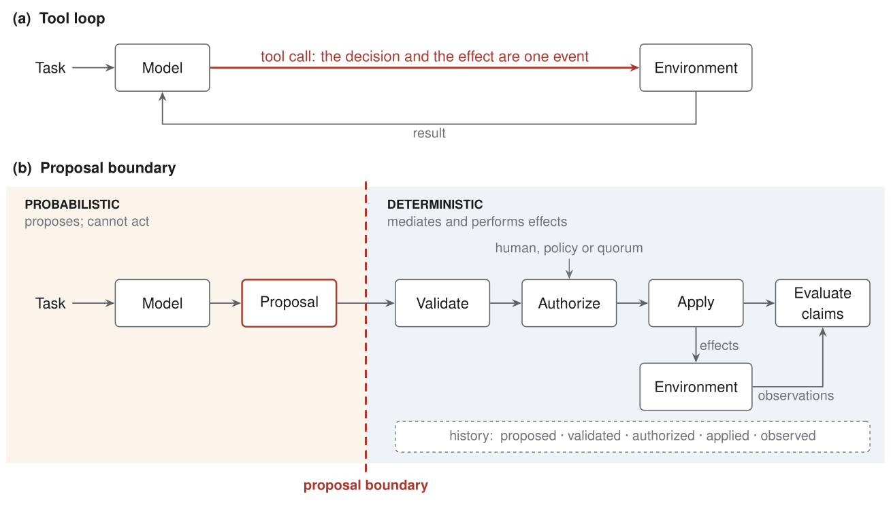

# The Proposal Boundary

**Constraining the interface between probabilistic reasoning and consequential execution**

Santosh Kumar · October 2026 · v0.1

The Proposal Boundary is an architectural pattern for constraining the interface between probabilistic reasoning and consequential execution.

This repository contains the architecture note and figures; Current's implementation remains private.

**[Read the note (PDF, 6 pages)](proposal-boundary.pdf)**

AI agents are usually built by giving a language model a set of tools and letting it call them from inside its reasoning loop. In that design, deciding that something should happen and causing it to happen are one event.

This note describes a different interface. The model holds no authority to cause effects. Its only output is a *proposal*: a value in a small language that names the operations it wants performed, the claims it makes about their outcome, and the evidence by which each claim can be checked. The runtime validates the proposal, obtains authorization for it, applies it, and checks its claims against what the runtime itself observed.



## The four properties

1. **No ambient authority.** The reasoner cannot cause effects. Its only output is a proposal.
2. **A bounded language.** A proposal is a value in a language of operations that the runtime defines. Output that does not decode into it is not a proposal.
3. **Independent existence.** A proposal exists before its execution and apart from it. It can be stored, read, validated, authorized, rejected, or never applied.
4. **Outcomes belong to the runtime.** Whether an operation happened, and whether a claim about it held, is established by what the runtime observed, never by what the reasoner reported.

Two consequences get a section each in the note. Authorization is not execution: approving a proposal changes its authorization state and causes no effects. Claims are not results: the agent says how a claim can be checked, and the runtime does the checking.

## Status

The note describes Current, an experimental runtime that implements the boundary for changes to software projects. Current's source is not public, and this repository contains none of it: only the note, its LaTeX source and its figures.

The note is an argument and a report of an implementation. It contains no measurements, and its Limitations section says what the design leaves unsolved: how an agent observes its environment without acting on it, operations too expressive for the language to confine, the burden of review, and the lack of atomicity.

## Citing

```bibtex
@misc{kumar2026proposalboundary,
  author       = {Santosh Kumar},
  title        = {The Proposal Boundary: Constraining the Interface Between
                  Probabilistic Reasoning and Consequential Execution},
  year         = {2026},
  month        = oct,
  note         = {Version 0.1},
  howpublished = {\url{https://github.com/santosh79/proposal-boundary}}
}
```

## Building

`make` rebuilds the figures and the PDF. It needs `pdflatex` and `pdftocairo`.

## License

This work is licensed under the Creative Commons Attribution 4.0 International License (CC BY 4.0).

© 2026 Santosh Kumar
